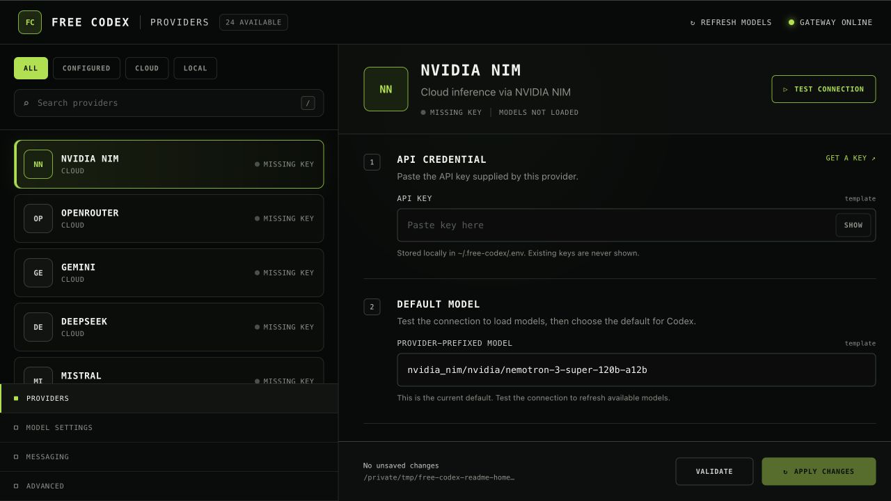
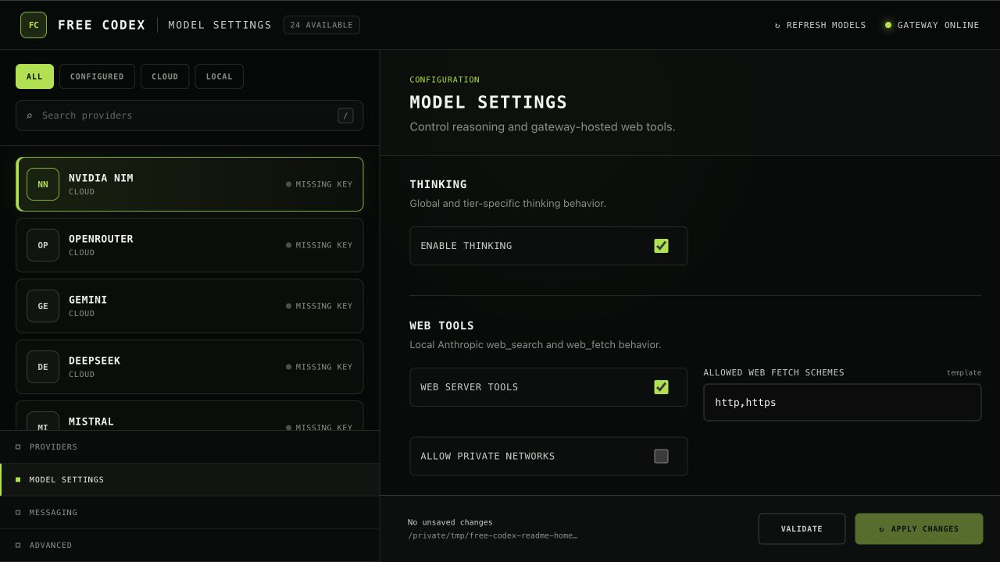

<div align="center">

# Free Codex

Run the Codex CLI with cloud, free-tier, or local models through a local OpenAI Responses gateway.

[Quick start](#quick-start) · [Using models](#using-models) · [Providers](#providers) · [Development](#development)

</div>

Free Codex keeps the normal Codex terminal experience—including tools, streaming,
resumable threads, and `/model`—while sending model requests to a provider you
choose.



## What you get

- The standard Codex CLI and its built-in tools.
- A local gateway compatible with the OpenAI Responses API.
- A browser-based Admin UI for API keys, connection tests, and model selection.
- 21 cloud provider integrations and 3 local runtimes.
- A generated catalog that makes provider models available through Codex `/model`.
- macOS, Linux, and Windows installers.

Free Codex does not provide models or bypass provider terms. Availability, pricing,
rate limits, and data handling are controlled by the provider you select.

## Quick start

### 1. Clone and install

```sh
git clone https://github.com/ishaanxgupta/free-codex.git
cd free-codex
```

macOS or Linux:

```sh
./scripts/install.sh
```

Windows PowerShell:

```powershell
.\scripts\install.ps1
```

The installer adds Codex CLI when it is missing, installs Astral `uv` and Python
3.14, and installs the three Free Codex commands.

### 2. Create your local configuration

```sh
free-codex-init
```

This creates `~/.free-codex/.env` (or `%USERPROFILE%\.free-codex\.env` on
Windows).

### 3. Start the gateway

```sh
free-codex-server
```

Keep this terminal open. The Admin UI opens automatically at
[http://127.0.0.1:8082/admin](http://127.0.0.1:8082/admin).

In the Admin UI:

1. Select a cloud provider or local runtime.
2. Paste its API key, or confirm the local endpoint.
3. Choose **Test connection** to load the provider's current models.
4. Select a default model and choose **Apply changes**.

API keys stay in the local `~/.free-codex/.env` file. Saved keys are masked in
the Admin UI.

### 4. Launch Codex

Open a second terminal in the repository you want Codex to work on:

```sh
free-codex
```

That is all that is required. Free Codex supplies the gateway URL, authentication,
default model, and model catalog to Codex for that launch; it does not permanently
rewrite your Codex configuration.

## Using models

Inside Codex, enter `/model` to choose any model discovered from your configured
providers.

You can also select a provider-prefixed model when launching:

```sh
free-codex --model "nvidia_nim/z-ai/glm-5.2"
```

Run a non-interactive task:

```sh
free-codex exec "explain this repository"
```

Use normal current Codex safety flags when needed:

```sh
free-codex --sandbox workspace-write --ask-for-approval never
```

The older `--full-auto` flag is not accepted by current Codex CLI versions.

## Admin UI

The Admin UI keeps provider credentials, model choice, reasoning settings, web
tools, messaging, and advanced runtime options in one place.



## Providers

The Admin UI is the source of truth for connection requirements and currently
available models. Choose **Get a key** for the selected cloud provider, then use
**Test connection** to discover its models.

<details>
<summary>All supported providers</summary>

| Provider | Credential or endpoint | Model format |
| --- | --- | --- |
| [NVIDIA NIM](https://build.nvidia.com/) | `NVIDIA_NIM_API_KEY` | `nvidia_nim/<model-id>` |
| [OpenRouter](https://openrouter.ai/) | `OPENROUTER_API_KEY` | `open_router/<provider>/<model>` |
| [Gemini](https://aistudio.google.com/) | `GEMINI_API_KEY` | `gemini/models/<model>` |
| [DeepSeek](https://platform.deepseek.com/) | `DEEPSEEK_API_KEY` | `deepseek/<model-id>` |
| [Mistral](https://console.mistral.ai/) | `MISTRAL_API_KEY` | `mistral/<model-id>` |
| [Mistral Codestral](https://console.mistral.ai/) | `CODESTRAL_API_KEY` | `mistral_codestral/<model-id>` |
| [OpenCode Zen](https://opencode.ai/) | `OPENCODE_API_KEY` | `opencode/<model-id>` |
| [OpenCode Go](https://opencode.ai/) | `OPENCODE_API_KEY` | `opencode_go/<model-id>` |
| [Vercel AI Gateway](https://vercel.com/docs/ai-gateway) | `AI_GATEWAY_API_KEY` | `vercel/<provider>/<model>` |
| [Hugging Face](https://huggingface.co/) | `HUGGINGFACE_API_KEY` | `huggingface/<model-id>` |
| [Cohere](https://cohere.com/) | `COHERE_API_KEY` | `cohere/<model-id>` |
| [GitHub Models](https://github.com/marketplace/models) | `GITHUB_MODELS_TOKEN` | `github_models/<model-id>` |
| [Wafer](https://www.wafer.ai/) | `WAFER_API_KEY` | `wafer/<model-id>` |
| [Kimi](https://platform.moonshot.cn/) | `KIMI_API_KEY` | `kimi/<model-id>` |
| [MiniMax](https://www.minimax.io/) | `MINIMAX_API_KEY` | `minimax/<model-id>` |
| [Cerebras](https://cloud.cerebras.ai/) | `CEREBRAS_API_KEY` | `cerebras/<model-id>` |
| [Groq](https://console.groq.com/) | `GROQ_API_KEY` | `groq/<model-id>` |
| [SambaNova](https://cloud.sambanova.ai/) | `SAMBANOVA_API_KEY` | `sambanova/<model-id>` |
| [Fireworks](https://fireworks.ai/) | `FIREWORKS_API_KEY` | `fireworks/<model-id>` |
| [Cloudflare Workers AI](https://developers.cloudflare.com/workers-ai/) | API token and account ID | `cloudflare/<model-id>` |
| [Z.ai](https://z.ai/) | `ZAI_API_KEY` | `zai/<model-id>` |
| [Ollama](https://ollama.com/) | `http://localhost:11434` | `ollama/<model-id>` |
| [LM Studio](https://lmstudio.ai/) | `http://localhost:1234/v1` | `lmstudio/<model-id>` |
| [llama.cpp](https://github.com/ggml-org/llama.cpp) | `http://localhost:8080/v1` | `llamacpp/<model-id>` |

</details>

## How it works

```text
Codex CLI
    │ OpenAI Responses requests
    ▼
Free Codex gateway at 127.0.0.1:8082
    │ model routing and protocol conversion
    ▼
Selected cloud provider or local runtime
```

Provider-specific behavior stays behind the gateway. Codex continues to use the
Responses contract for streaming text, reasoning, tool calls, and usage events.
See [ARCHITECTURE.md](ARCHITECTURE.md) for implementation details.

## Configuration

The Admin UI writes settings to `~/.free-codex/.env`. Common values are:

```dotenv
MODEL="open_router/openrouter/free"
FREE_CODEX_AUTH_TOKEN="free-codex"
FREE_CODEX_OPEN_BROWSER=true
```

`MODEL` must include the Free Codex provider prefix, such as `open_router/`,
`nvidia_nim/`, `gemini/`, or `ollama/`.

## Security

- The Admin UI only accepts loopback clients.
- API keys are stored locally and masked in the UI.
- Raw prompts and provider payloads are not logged unless diagnostic logging is
  explicitly enabled.
- Set a strong `FREE_CODEX_AUTH_TOKEN` before exposing the gateway beyond your
  own machine.
- Review the selected provider's privacy, retention, and acceptable-use policies
  before sending source code.

## Development

Requirements: `uv >= 0.11` and Python 3.14.

```sh
uv sync
uv run ruff format
uv run ruff check
uv run ty check
uv run pytest
```

Run the platform CI helper before publishing:

```sh
./scripts/ci.sh
```

Windows PowerShell:

```powershell
.\scripts\ci.ps1
```

## Uninstall

macOS or Linux:

```sh
./scripts/uninstall.sh
```

Windows PowerShell:

```powershell
.\scripts\uninstall.ps1
```

The uninstaller removes the Free Codex `uv` tool and `~/.free-codex/`. It
does not remove Codex CLI, `uv`, or `uv`-managed Python runtimes.

## License

MIT. See [LICENSE](LICENSE).
